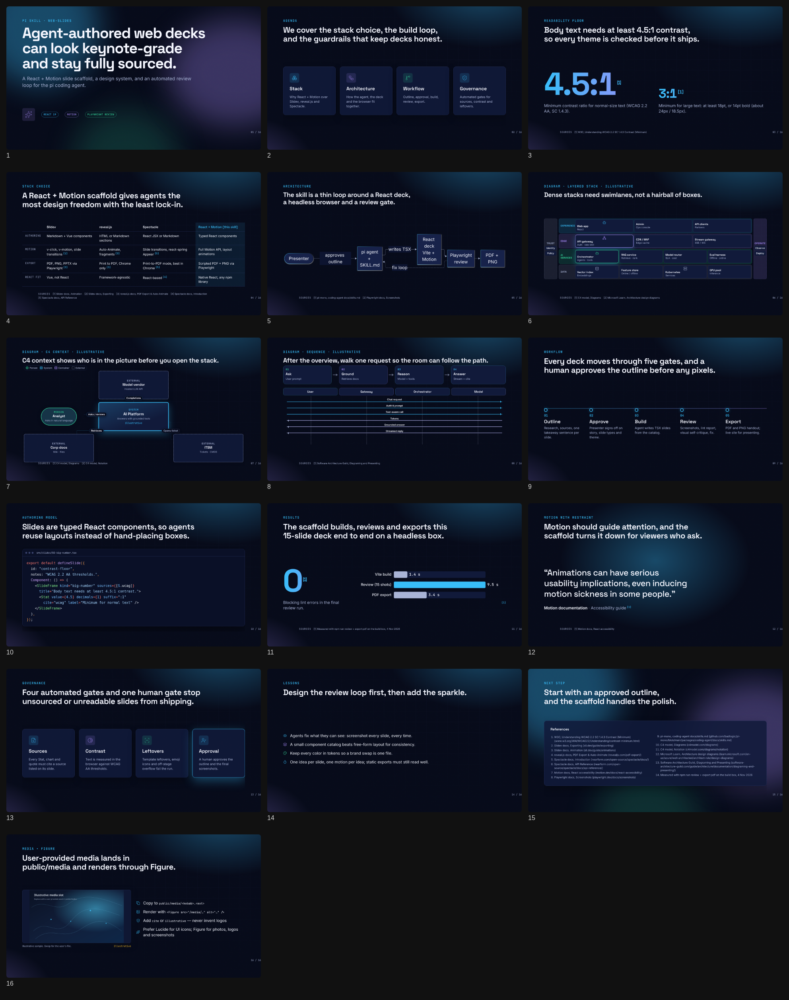

# pi-slides-skill

An agent skill for the [pi coding agent](https://github.com/badlogic/pi-mono) that builds **stunning, research-backed web slide decks**. Decks are React 19 + Vite + Motion apps on a 1920×1080 stage. Every slide is screenshotted and linted automatically, and the deck exports to PDF and PNG.

Dark theme, styled from the Apple website as a reference:


Light theme, with images researched from the web and added motion:




## What it does

- **Workflow:** brief → research → **editable design spec** (`content/deck.spec.yaml`) → **your approval** → build from spec → screenshots → self-review checklist → PDF export. Regenerating stubs does not wipe `status: locked` slides.
- **A deck standard enforced by code**, not just by instructions:
  - Every Stat, chart or quote must cite a source listed on its slide.
  - Titles must be full-sentence takeaways.
  - Contrast is checked against WCAG 2.2 AA, both at the token level and in the rendered DOM.
  - The lint fails on emoji icons, template leftovers (lorem, TODO, `{{ }}`, NaN), overflow and text under 18px.
- **13 slide types with working examples:** title, agenda, big number, architecture (Mermaid **or** React swimlanes / C4 / sequence), comparison, timeline, code walkthrough (Shiki with per-step focus), quote, results (count-up stat + animated bars), governance, lessons, closing and section.
- **Diagram guide:** `skills/web-slides/references/diagram-guide.md` teaches when to use Mermaid (≤8 nodes) vs `LayeredArchitecture`, `FlowSteps`, `Sequence`, `C4Container` (React + CSS, no heavy graph library).
- **Layout guide:** `skills/web-slides/references/layout-guide.md` — presentation Flexbox + Grid recipes (KPI strip, compare, hero+chart), overflow rules; cites CSS Tricks Flexbox/Grid.
- **Design spec:** `skills/web-slides/references/deck-spec.md` — YAML middle layer (slide types, layouts, components, chart data, notes) with approval gate and promote/merge rules; `npm run spec` validates and generates stubs.
- **Media guide:** `skills/web-slides/references/media-guide.md` teaches the **agent** to copy user-provided logos/screenshots into `public/media/` and render them with `<Figure>` (alt + cite/illustrative, lint for missing alt / broken src).
- **Swappable theme tokens:** the built-in themes are `midnight`, `aurora` and `paper`. A brand palette goes in `brand.css` and is a single-file change.
- **Template inspiration:** curated free tech Google Slides / PowerPoint packs (SlidesCarnival, Slidesgo, …) used as **style references** only — palettes + layout recipes via `style:images`, never vendored PPTX. See [docs/template-inspiration.md](docs/template-inspiration.md).
- **Style import:** `npm run style:url -- <url>`, `style:images -- <dir>` and `style:svg -- <dir>` turn a website, a mood board or SVG artwork into `style-spec.json` plus a WCAG-checked `[data-theme="brand"]`. The importer extracts colors, swaps proprietary fonts for free ones, maps layout feel to tokens and normalizes SVGs. It borrows style, never assets.
- **Presenting:** arrow keys or clicks with click-steps, **N** notes, **O** overview, **F** fullscreen, and `prefers-reduced-motion` respected.

## Install into pi

This repo is a pi package. `package.json` declares `"pi": { "skills": ["./skills"] }`.

```bash
# from GitHub
pi install git:github.com/jasonli0226/pi-slides-skill

# or from a local clone
git clone https://github.com/jasonli0226/pi-slides-skill && pi install ./pi-slides-skill

# or copy only the skill
cp -r pi-slides-skill/skills/web-slides ~/.pi/agent/skills/web-slides
```

Add `-l` to `pi install` to write to the project's `.pi/settings.json` instead of `~/.pi/agent/settings.json`. Then ask pi for a deck ("make a 10-minute deck on …"), or force the skill with `/skill:web-slides`. After editing the skill, run `/reload`.

Requirements: Node.js 20+, npm, and Chromium for Playwright (`npx playwright install chromium`, or set `CHROME_PATH`).

## Use the scaffold directly

```bash
node skills/web-slides/scripts/new-deck.mjs ./my-deck --title "Our pilot cut triage time in half." --theme midnight
cd my-deck && npm install && npx playwright install chromium
npm run dev          # present mode + HMR — edit slides, browser updates live
npm run live         # HMR + watch content/deck.outline.md → generated stub slides
npm run outline      # regenerate outline stubs once (no Vite)
npm run spec         # validate content/deck.spec.yaml + generate stub slides (status:stub only)
npm run review       # screenshots + lint → review/ (contact-sheet.png, report.md)
npm run export:pdf   # export/deck.pdf   (add -- --raster for a pixel-exact PDF)
npm run verify       # tokens + typecheck + build + review + pdf, exit code for CI
```

## Develop this repo

```bash
npm test   # scaffold smoke test, token/scaffold checks, present-mode browser tests
```

The tests scaffold decks into a temp dir and run `npm ci` there, so they need network or an npm cache, plus Chromium for Playwright. CI runs them on Node 20, 22 and 24.

## Repo layout

```
package.json                     pi package manifest
skills/web-slides/
  SKILL.md                       entry point pi loads (frontmatter + workflow + standard)
  references/
    design-guide.md              story, layout, type scale, color, icons, motion, data
    layout-guide.md              Flexbox + Grid recipes for the 1920×1080 stage
    deck-spec.md                 editable YAML design spec + approval / promote rules
    diagram-guide.md             scenario → diagram type, beauty rules, anti-patterns
    slide-catalog.md             slide types, component props, file skeleton
    workflow.md                  step-by-step commands and approval gate
    style-import.md              URL / images / SVG → brand theme, font swaps, licensing
    media-guide.md               user logos/screenshots → public/media + <Figure>
    review-checklist.md          automated + visual + facts checklist
  fixtures/style-import/         generated CC0 sample images + SVGs for the importers
  scripts/new-deck.mjs           create a deck from the template
  template/                      the deck engine + example slides + live outline
    src/deck/                    Deck (modes, keys, transitions), components, CSS
    src/theme/tokens.css         all design tokens + 3 themes
    src/theme/brand.css          where the brand theme goes
    src/slides/                  one file per slide, sources.ts bibliography
    content/deck.spec.yaml       editable design spec (approval artifact)
    content/deck.outline.md      optional light outline (titles/bullets)
    scripts/                     review, live, spec, watch-outline, export-pdf, check-tokens
    scripts/style/               style:url, style:images, style:svg (+ shared color/k-means lib)
test/                            scaffold smoke, check and present-mode tests (npm test)
docs/research.md                 stack comparison, decision, sources
docs/verification.md             what was run and the results
examples/                        example-deck.pdf, review-report.md, screenshots/
```

## Live mode

**React slides stay the source of truth.** For real-time updates:

1. `npm run dev` — Vite HMR present mode at http://127.0.0.1:5173. Change any slide TSX, theme token, or diagram component and the stage refreshes immediately.
2. `npm run live` — same server, plus a watcher on `content/deck.outline.md` that rewrites `src/slides/generated/from-outline.tsx`. Uncomment the `outlineSlides` import and the `...outlineSlides` spread in `src/slides/index.ts` to see stubs in the deck; then promote each stub into a hand-crafted slide file (diagrams, motion, layout) before `npm run review`.

Caveat: the outline → TSX path is intentionally thin (title + bullets). It will not invent C4 / swimlanes / charts. Beauty work stays in React.

## Research summary

We compared Slidev, reveal.js, Spectacle and a custom React + Motion scaffold (details in [docs/research.md](docs/research.md)).

- **Chosen: custom React + Vite + Motion.** The brief asked for React. Plain TSX components give agents complete layout and animation freedom with well-known libraries. Our own URL modes (`?static`, `?print`) make Playwright screenshots, DOM linting and PDF export deterministic, which is what lets the agent review its own work.
- **Runner-up: Slidev** (Markdown + Vue). It has the richest built-ins: PPTX/PDF/PNG export via Playwright, presenter mode and Shiki Magic Move. Its plain PPTX export is images, and even `pptx-editable` keeps SVG/Mermaid as pictures.
- **reveal.js** has Auto-Animate and fragments, and its `?print-pdf` export is documented for Chrome/Chromium. **Spectacle** is React with a `transition` prop, react-spring Appear/Stepper, and a print mode whose custom page size works fully only in Chrome.
- **Accessibility:** WCAG 2.2 SC 1.4.3 requires 4.5:1 contrast (3:1 for large text). Motion's `reducedMotion="user"` turns off transform and layout animation for users who request it.

### Sources

- Slidev: [Animation](https://sli.dev/guide/animations), [Exporting](https://sli.dev/guide/exporting)
- reveal.js: [PDF Export](https://revealjs.com/pdf-export/), [Auto-Animate](https://revealjs.com/auto-animate/), [Code](https://revealjs.com/code/)
- Spectacle: [Introduction](https://nearform.com/open-source/spectacle/docs/), [API Reference](https://nearform.com/open-source/spectacle/docs/api-reference/)
- Motion: [React accessibility](https://motion.dev/docs/react-accessibility)
- Playwright: [Screenshots](https://playwright.dev/docs/screenshots)
- W3C: [Understanding WCAG 2.2 SC 1.4.3](https://www.w3.org/WAI/WCAG22/Understanding/contrast-minimum.html)
- pi-mono: [skills.md](https://github.com/badlogic/pi-mono/blob/main/packages/coding-agent/docs/skills.md), [packages.md](https://github.com/badlogic/pi-mono/blob/main/packages/coding-agent/docs/packages.md)

## Known limits

- The presenter view is an in-page notes overlay, not a separate presenter window.
- Automatic contrast checking covers text on solid or semi-transparent backgrounds. Gradient text and text over glows or images must be checked by eye (it's on the checklist).
- There is no editable PPTX output; hand-off is PDF and PNG.
- The vector PDF drops the grain overlay and renders gradient text in the solid accent color. Use `--raster` for a pixel-exact copy.
- The committed `brand.css` is empty. Generate one with `npm run style:*` or write it by hand.
- Style import is heuristic. A page with a full-bleed hero photo or video, or a cookie wall, can skew bg or accent detection, so check the spec against the captures. Sites that block headless browsers need a user screenshot passed to `style:images`. SVG parsing is regex-based (no svgo unless installed) and does not resolve CSS classes in `<style>` blocks.

## License

MIT
